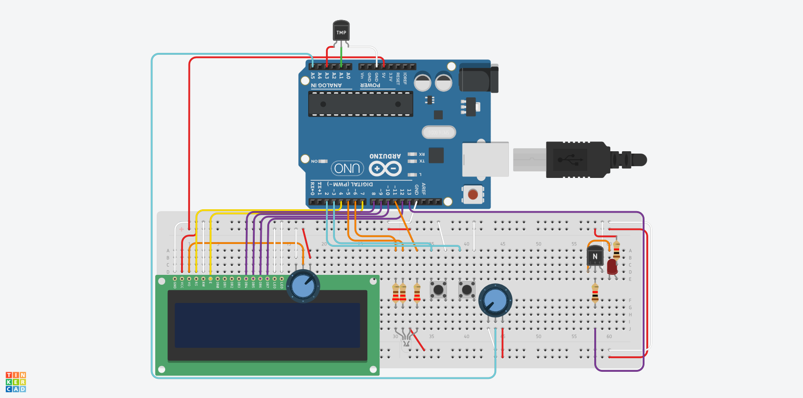

# arduino_thermostat

## Brief Overview

This project implements a simple thermostat. System periodically samples temperature with an LM35 sensor and compares it with a user-selected target temperature. Current and target temperatures are displayed on a 16x2 LCD screen. Depending on the difference, the system enters one of three states (`COLD`, `NORMAL`, `HOT`), which are indicated with an RGB LED. In case of the state `HOT`, an NPN transistor connects the circuit of a cooling fan (a red LED is used in the project instead).


## Main Features

- System is a state machine, operating in four states: `OFF`, `COLD`, `NORMAL`, and `HOT`.
- System can be turned `ON` or `OFF` with the system button (red button). When turned `ON`, the state depends on current and target temperatures. System state is displayed via RGB LED: blue = `COLD`, green = `NORMAL`, red = `HOT`.
- Temperature is sampled periodically using Timer1 and shown on the LCD and over Serial.
- The target temperature is set with a potentiometer in a separate edit mode, entered and confirmed with the save button (black button). The target temperature can be set in the interval that is chosen as a parameter in code.
- While editing, the LCD shows both the current target and the pending value, e.g. `Target: 20 [27]`.
- Target temperature and last system state that were saved are recovered after a power cycle.
- Serial output for temperature readings, state changes, and saved settings.

## Build Steps

- Connect the physical components according to the schema presented at the end of the README.
- Connect Arduino Uno R3 to your computer.
- Using Arduino IDE (recommended) or other platform, compile and upload project code to the Arduino Uno R3.

## Used Components

- Arduino Uno R3.
- LM35 temperature sensor.
- Two potentiometers (10K Ohm for target temperature, 50K Ohm for LCD contrast adjustment).
- 16x2 character LCD.
- RGB LED (common anode).
- Red LED (instead of a cooling fan).
- Two push buttons (red system button and black save button).
- NPN transistor.
- Five 220 Ohm resistors for LEDs and LCD anode, one 1K Ohm resistor for NPN. 
- Breadboard and connecting wires.

## Interrupts

System has 3 interrupts - one per push button and one timer interrupt. Push button interrupts are meant to change the system state (red button) or enter edit mode / save current config (black button), while timer interrupt is used for periodically sampling the LM35 and potentiometer, displaying LCD and printing to Serial.

## Timer

System uses 16-bit Timer1 as its timer. Timer1 uses CTC mode with a prescaler of 1024. One full cycle of the timer is approximately 10ms, after which the timer interrupts. Timer config:

```cpp
  TCCR1A = 0;
  TCCR1B = 0;
  TCNT1 = 0;                            // timer itself
  OCR1A = 156;                          // 10 ms / 0.064 ms = 156.25
  TCCR1B |= (1 << WGM12);               // CTC mode: clear timer on compare match
  TIMSK1 |= (1 << OCIE1A);              // enable compare match A interrupt
  TCCR1B |= (1 << CS12) | (1 << CS10);  // set prescaler 1024, this also starts the timer
```

## Direct Port Manipulation

The LM35 is powered from pin A3, which is configured as an output and set HIGH using direct port manipulation (memory-mapped I/O) instead of `pinMode` and `digitalWrite`. A3 is bit 3 of port C:

```cpp
  DDRC  |= (1 << 3);  // set bit 3 of the port C direction register: A3 is an output
  PORTC |= (1 << 3);  // set bit 3 of the port C output register: A3 is HIGH
```

## EEPROM Storage

EEPROM is used to preserve the system state and the target temperature across power cycles. Magic number and version are used to validate the stored configuration. If the data is missing or invalid, defaults are written (target 20 degrees Celsius, state `OFF`).

### EEPROM Layout

| Address | Size | Field | Description |
|---|---:|---|---|
| 0 | 1 byte | Magic number | Identifies valid project data (`0xAC`) |
| 1 | 1 byte | Version | Identifies the EEPROM data format |
| 2 | 1 byte | System state | `0` = OFF, `1` = COLD, `2` = NORMAL, `3` = HOT |
| 3 onward | `sizeof(int)` bytes | Target temperature | Stores the target temperature in degrees Celsius |

After a power cycle, a stored state other than `OFF` means the system was on. The actual state is then recalculated from the first temperature reading.

## Wiring


